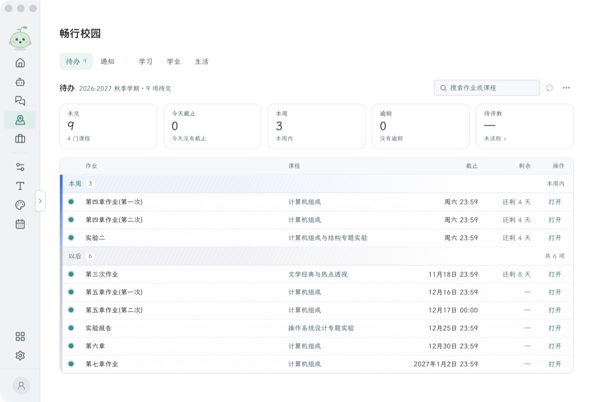
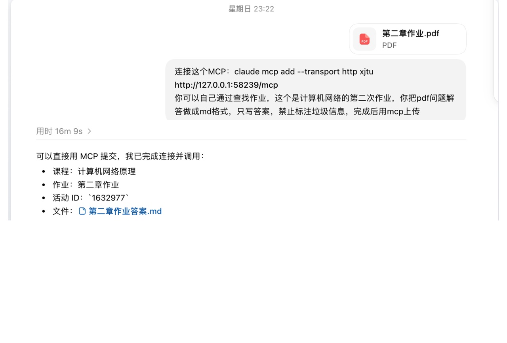

# XJTU Launcher

**把交大人的校园生活，收进一个桌面应用。**

校园账号、课表、成绩、考勤、校园卡、空闲教室、图书馆、场馆、思源学堂、评教、工作台、社区广场，以及可以调用这些能力的 Agent 和本机 MCP 接口——都放在同一个窗口里。

## 它是什么

XJTU Launcher 是面向西安交通大学学生的桌面校园工作台。不用再在浏览器标签、教务网站和各类小程序之间来回切换：登录一次校园账号，课表、考试、成绩、考勤、校园卡、体测、空闲教室、全校课程、校历、评教、图书馆、场馆和思源学堂都在这一个应用里完成。

它不是把网页塞进客户端，而是用 Rust 直接对接校园系统的协议：会话留在本机，查询走原生请求，界面用桌面应用的方式重新组织。少一点“打开网页—登录—找入口”，多一点“想查什么，直接就在这里”。

应用本身也是一个可以扩展的桌面工作台：校园功能做成内置插件，主题、主页元素可以定制；工作台直接管理你自己的课程文件夹；内置的 Agent 能查询校园数据；打开本机 MCP 模式后，Claude Code 等编程 Agent 也能直接调用同一批校园工具。

## 主要能力

### 校园账号与课表

- **一处登录**：账号密码、手机号短信验证码、扫码登录三种方式；多账号保存、图片验证码与短信验证、可把本机登记为可信设备、WebVPN 自动回退，密码可选保存；凭据只存在本机的 `~/.xjtu-launcher/auth.json`
- **课表**：今日课程与完整学期课表，按周切换；近校园网自动刷新，登录状态失效时提示重新连接
- **课表自定义**：点课程块修改名称、教师、地点、周次、节次与颜色，可隐藏课程，也能添加只存在本机的自建课程；改动只保存在本机，随时可恢复学校原始内容
- **校园导航**：需要查看原网站时，在独立窗口里复用登录状态打开一网通办、教务系统、思源学堂和图书馆，不用重新登录，也不会影响主窗口
- **主页通知**：主页默认展示可上下滚动的教务处教学通知，点击在校园窗口打开原文；可在「主页主题」里换成插件区或其他元素

### 学习

- **成绩查询**：按学期查看课程成绩与绩点
- **考试安排**：考试时间、地点与考场
- **空闲教室**：按日期与节次查询可用自习教室
- **全校课程**：按学期和课程名检索开课信息
- **校历**：学年、学期与假期安排
- **学籍档案**：个人学籍信息
- **一键评教**：先预览评教内容，确认后由你主动提交；结果不明时不会自动重试

### 校园生活

- **考勤查询**：刷卡流水与课程考勤记录
- **校园卡**：余额与最近 30 天流水
- **体测成绩**：体测项目与总分
- **图书馆**：楼层、区域与实时座位
- **场馆预约**：场馆时段与我的预订
- **思源学堂**：课程按学期分组，作业 / 学习资料 / 课程回放 / 在线视频 / 讨论等按类型切换；活动详情可查看附件、另存文件，录播课可直接获取回放地址；Agent 可查看作业提交记录、分数与教师批语，也能上传作业附件并提交（先预览、再确认）
- **教务处通知**：按栏目读取教务处、学生处、研究生院与网络信息中心的公开通知

### 社区广场

- 五个板块：社团、课程攻略、校园生活、生涯分享、资源导航
- 默认导航页用矩形板块卡展示，中下部分提供全局搜索框与「普通 / Agent」模式切换
- Agent 模式需要在 Agent 设置里开启「搜索服务 Agent」，并配置可用的模型；模型不可达时会置灰并说明原因
- **当前边界**：板块页与详情页仍是「待开发」占位，内容包也还没落地；社区广场目前是导航页，不是已经有丰富内容的论坛

### 工作台

- 直接读写你自己的 `xjtu-launcher-file/workspace/<账号>/`，不另建私有文件库
- 根目录是学期文件夹（如 `2026-2027 秋季学期`），其下是课程文件夹；可以在任意层级新建文件夹，也可以在访达里改名、移动
- 课程身份按课程编号识别，文件夹改名后仍能认回同一门课
- 右侧文件树、课程卡片、作业清单与文件列表；支持打开、在访达中显示、添加文件、删除前确认
- 作业提交：选文件或只填文字 → 预览 → 明确确认后上传；提交成功后可按设置把文件复制并绑定到课程文件夹，失败只警告，不改变提交结果

### Agent

- **流式对话**：回答过程中可停止；对话在本机持久保存，切换页面不会中断。回复按 Markdown 渲染，代码、列表、表格和链接都能正常显示；右侧刻度对应每一轮提问，悬停预览、点击跳转
- **工具循环**：可以查询课表、成绩、考试、考勤、校园卡、体测、学籍、空闲教室、全校课程、校历、评教列表、思源学堂、图书馆与场馆，也能读取公开通知；改课表、交作业、评教、工作台文件编辑都先给预览，你确认后才生效；还会调用你在 Agent 设置里启用的 MCP 工具
- **思源学堂作业**：说清要交的作业和本地文件后，Agent 先返回课程、作业、截止时间、文件与文字的预览；你明确同意后才上传附件并提交。提交结果不明时不会自动重试
- **评教**：Agent 可以自动填写待评问卷，并给某位老师单独指定评语；先返回逐门课程的预览，你说提交后才真正提交
- **对话管理**：历史记录、置顶、搜索、重命名、删除与工作区分组
- **角色与 Skill**：内置角色、预设任务和 Skill 目录；输入框旁用 `+` 选择角色、`@` 引用 Skill
- **全局记忆**：自动注入系统提示词，可手动维护，也能由模型写入
- **多厂商模型**：兼容 OpenAI 兼容接口、Anthropic 与 Gemini；模型在对话框里选择，输入框显示上下文用量圆环与厂商余额

### 本机 MCP 接口

个人页可以打开 **MCP 模式**，把校园能力直接开放给 Claude Code 等编程 Agent：

- 在 `http://127.0.0.1:39217/mcp` 提供 MCP 服务，端口可自行修改；应用失败会回到原端口并说明原因
- 内置 **17 个工具**：13 个只读查询 + 4 个写工具。只读查询按领域合并，用 `action` 参数选择具体能力；写工具保持独立，便于在 MCP 页面单独关闭写能力
- 只读覆盖课表、成绩、考试、校历、学籍、全校课程、考勤、校园卡、体测、空闲教室、评教列表、通知、思源学堂、图书馆、场馆与工作台文件
- 4 个写工具：`campus_timetable_edit` 只改本机课表，`campus_lms_submit` 提交思源学堂作业，`campus_evaluations_submit` 提交评教，`workbench_edit` 建文件夹 / 导入 / 绑定 / 删除工作台文件。全部默认只预览，用户明确要求后才带 `confirm=true`；结果不明时不自动重试
- 逐项勾选开放哪些工具；未勾选的工具不会出现在 `tools/list` 中
- 一键复制地址与 `claude mcp add` 命令，也能实际检查校园会话是否可用
- 仅监听本机回环地址，不经过启动器账号。接口无请求认证，请勿把端口暴露到局域网

### 插件中心

- 只展示**随应用发布的内置插件**，分「校园广场 / 拓展发明 / 创新小港 / 已安装插件」四个分区
- 行式布局：名称、右侧简述和启用开关；单击展开作者、版本、许可与详细描述，有第三方素材时再显示署名
- 目前 7 个内置插件：课程表、畅行校园、桌面宠物、字体美化、主页主题、Agent 设置、回放截取
- 课程表、畅行校园、主页主题、Agent 设置、回放截取默认启用；桌面宠物与字体美化默认关闭
- **没有远端市场、下载、安装与卸载**（2026-11-08 起）；插件只有启用开关，侧栏入口跟随启用状态

### 桌面体验

- 系统原生标题栏、可收起与拖宽的侧栏、六只各带独立配色的侧栏宠物
- **最小化桌宠**：主窗口最小化后出现浮动桌宠和通知横条（关闭窗口仍然是关闭）；四只内置角色、玻璃 / 深色玻璃 / 纯白三种横条风格；横条显示校园通知、Agent 任务完成与更新提示；点击横条还原应用，双击桌宠可选择「只保留桌宠」或打开设置
- **字体美化**：全局、标题、正文、代码四个类别可分别设置字体、颜色、字号、字重、行高与字距；内置霞鹜文楷、霞鹜新晰黑、思源宋体、更纱黑体四个字体库，也支持添加本机字体文件
- 主题色、自定义壁纸、主页时钟风格、主页分区开关与显示顺序
- 壁纸「清晰 / 均衡 / 透亮」三档显示，长页面文字在深色壁纸下仍可读
- 减少动态效果选项，尊重系统的“减弱动态效果”设置
- 课表、成绩、校园卡等页面先显示上次结果，再在后台取回最新数据；缓存按校园账号隔离

## 当前状态与验收边界

- **代码已实现、自动测试通过、待用户 / 真机验收**：内置插件中心、工作台 v2、社区广场默认页、字体库、壁纸三档、MCP 17 个工具、工作台提交后自动归档。
- **待真实账号验证**：字体真实下载与渲染、社区 Agent 回答、评教正式提交、思源学堂作业正式提交、图书馆 / 场馆页面、手机号与扫码登录。
- **待部署**：官网改版重新部署、`xjtu-launcher.cn` 的 ICP 备案与 HTTPS。更新源目前仍是临时 HTTP 地址（P0）。
- **未获准的设计**：畅行校园整体视觉重做、Agent / 评教页新稿、最小化桌宠设计。未获准前不按旧稿改视觉。
- **Windows**：安装、启动、校园登录、课表与自动更新还没有 Windows 实机记录，不宣称已在 Windows 验证。

完整的开发待办见 [todo_list.md](todo_list.md)，验收状态见 [acceptance_list.md](acceptance_list.md)，技术背景见 [dev-docs/planning/need-do.md](dev-docs/planning/need-do.md)。

## 下载安装

先确认你的电脑，再点对应的链接，下载后直接安装即可：

- 🍎 **Mac，Apple 芯片**（M1 / M2 / M3 / M4，2020 年之后的机型）→ **[点击下载 .dmg](https://github.com/haiziyao/XJTU-Launcher/releases/download/v0.6.6/XJTU.Launcher_0.6.6_aarch64.dmg)**
- 🍎 **Mac，Intel 芯片**（2020 年之前的机型）→ **[点击下载 .dmg](https://github.com/haiziyao/XJTU-Launcher/releases/download/v0.6.6/XJTU.Launcher_0.6.6_x64.dmg)**
- 🪟 **Windows 64 位**（Windows 10 / 11）→ **[点击下载 .exe](https://github.com/haiziyao/XJTU-Launcher/releases/download/v0.6.6/XJTU.Launcher_0.6.6_x64-setup.exe)**

不确定自己是什么芯片？Mac 左上角 →「关于本机」，看“芯片”一栏：写着 Apple M 系列就选第一个，写着 Intel 就选第二个。

> ⚠️ **系统要求**：macOS 12+ 或 Windows 10 / 11；Windows 需要 WebView2（Windows 11 已内置，缺失时安装程序会下载安装）。

> **macOS 首次打开**：安装包做了 ad-hoc 签名，不会报“已损坏”，但还没有 Developer ID 与公证，可能提示“无法验证开发者”。右键 →「打开」，或到“系统设置 → 隐私与安全性”点「仍要打开」。Windows 可能出现 SmartScreen 提示（「更多信息」→「仍要运行」）。

> **0.5.1 已撤回**：该版本的 macOS 包只有二进制签名，打开会提示“已损坏，无法打开”。请下载上面的 0.6.6 覆盖安装；已经装过 0.5.1 的用户也直接覆盖。

其他版本、更新说明和历史安装包都在 **[Releases 页面](https://github.com/haiziyao/XJTU-Launcher/releases)**。每个版本改了什么、验证到什么程度，见 [版本发布记录](docs/releases/README.md)。

## 开发

技术栈为 **Rust + Tauri 2 + Vue 3 + TypeScript**。开始开发前先读：

- [dev.md](dev.md)：开发须知、目录、分支与检查命令
- [todo_list.md](todo_list.md)：只记没做的开发项与未来方向
- [acceptance_list.md](acceptance_list.md)：待验收与已验证内容
- [开发文档索引](dev-docs/README.md)
- [约定手册](dev-docs/CONVENTIONS.md)
- [需求时间线](dev-docs/planning/need-do.md)

项目 skill 在 [skills/](skills/)：`xjtul-style`（样式与组件）、`xjtul-plugin`（内置插件）、`xjtul-push`（推送与发版）。

## 致谢

特别感谢 [**XJTUToolBox（仙交百宝箱）**](https://github.com/yan-xiaoo/XJTUToolBox)：一个基于 PyQt5 的优秀校园工具箱，覆盖课表、考勤、评教、成绩、思源学堂等场景。本项目的校园协议、接口行为与交互思路大量参考自它，没有它就没有今天的 XJTU Launcher。强烈推荐前往仓库 Star、关注并参与贡献：[yan-xiaoo/XJTUToolBox](https://github.com/yan-xiaoo/XJTUToolBox)。

XJTUToolBox 以 **GPL-3.0** 许可证发布；本项目按其公开行为独立用 Rust 重新实现，不复制其源码，也不将其作为运行时依赖。若未来直接复用其代码，将按其许可证要求处理。

「回放截取」插件的采样、翻页判定与 PDF / ZIP 导出移植自 [XJTU-PPT-Capture-Extension](https://github.com/MeowSaint/XJTU-PPT-Capture-Extension)（MIT，Copyright (c) 2026 MeowSaint and contributors），用 TypeScript 重写并适配本项目。逐文件说明与许可证文本见 [THIRD_PARTY_NOTICES.md](THIRD_PARTY_NOTICES.md)。

同时感谢 [Tauri](https://tauri.app/)、[Vue](https://vuejs.org/)、[lucide](https://lucide.dev/)、[Noto Sans SC](https://fonts.google.com/noto/specimen/Noto+Sans+SC) 等开源项目。

## 许可证

本项目以 [MIT](LICENSE) 许可证开源，Copyright (c) 2026 haiziyao。

内嵌的 Noto Sans SC 字体按其 SIL Open Font License 1.1 分发，许可证文本见 `src/assets/fonts/OFL.txt`。

桌面宠物的四张精灵图来自社区 Codex Pet 生态，**不适用 MIT**，仅限非商业使用并保留作者署名；逐项来源与条款见 `src/assets/pets/NOTICE.md`。本项目免费、非商业，不售卖这些素材，也不与 DeepSeek、OpenAI、Anthropic 存在隶属关系。
