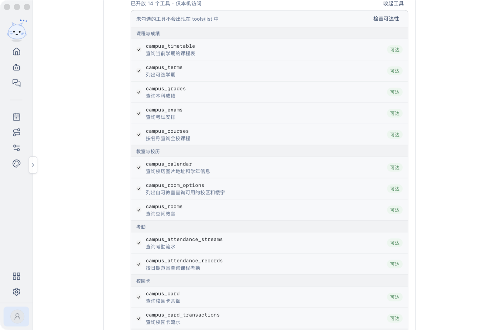

# XJTU Launcher

**把交大人的校园生活，收进一个桌面应用。**

校园账号、课表、成绩、考勤、校园卡、空闲教室、图书馆、场馆、思源学堂、评教，以及可以调用这些能力的 Agent 和本机 MCP 接口——都放在同一个窗口里。

## 它是什么

XJTU Launcher 是面向西安交通大学学生的桌面校园工作台。不用再在浏览器标签、教务网站和各类小程序之间来回切换：登录一次校园账号，课表、考试、成绩、考勤、校园卡、体测、空闲教室、全校课程、校历、评教、图书馆、场馆和思源学堂都在这一个应用里完成。

它不是把网页塞进客户端，而是用 Rust 直接对接校园系统的协议：会话留在本机，查询走原生请求，界面用桌面应用的方式重新组织。少一点“打开网页—登录—找入口”，多一点“想查什么，直接就在这里”。

应用本身也是一个可以扩展的桌面工作台：校园功能做成插件，主题、主页元素可以定制；内置的 Agent 能查询校园数据；打开本机 MCP 模式后，Claude Code 等编程 Agent 也能直接调用同一批校园工具。

## 主要能力

### 校园账号与课表

- **一处登录**：多账号保存、验证码与短信验证、WebVPN 自动回退，密码可选保存；凭据只存在本机的 `~/.xjtu-launcher/auth.json`
- **课表**：今日课程与完整学期课表，按周切换；近校园网自动刷新，登录状态失效时提示重新连接
- **校园导航**：需要查看原网站时，在独立窗口里复用登录状态打开一网通办、教务系统、思源学堂和图书馆，不用重新登录，也不会影响主窗口

### 学习

- **成绩查询**：按学期查看课程成绩与绩点
- **考试安排**：考试时间、地点与考场
- **空闲教室**：按日期与节次查询可用自习教室
- **全校课程**：按学期和课程名检索开课信息
- **校历**：学年、学期与假期安排
- **学籍档案**：个人学籍信息
- **一键评教**：先预览评教内容，确认后由你主动提交；结果不明时不会自动重试

### 校园生活

- **考勤查询**：刷卡流水与课程考勤记录
- **校园卡**：余额与最近 30 天流水
- **体测成绩**：体测项目与总分
- **图书馆**：楼层、区域与实时座位
- **场馆预约**：场馆时段与我的预订
- **思源学堂**：课程按学期分组，作业 / 学习资料 / 课程回放 / 在线视频 / 讨论等按类型切换；活动详情可查看附件、另存文件，录播课可直接获取回放地址；Agent 可上传作业附件并提交（先预览、再确认）

### Agent

- **流式对话**：回答过程中可停止；对话在本机持久保存，切换页面不会中断
- **工具循环**：可以查询课表、成绩、考试、考勤、校园卡、体测、学籍、空闲教室、全校课程、校历、评教列表、思源学堂、图书馆与场馆，也会调用你在 Agent 设置里启用的 MCP 工具
- **思源学堂作业**：说清要交的作业和本地文件后，Agent 先返回课程、作业、截止时间、文件与文字的预览；你明确同意后才上传附件并提交。提交结果不明时不会自动重试
- **对话管理**：历史记录、置顶、搜索、重命名、删除与工作区分组
- **角色与 Skill**：内置角色、预设任务和 Skill 目录；输入框旁用 `+` 选择角色、`@` 引用 Skill
- **全局记忆**：自动注入系统提示词，可手动维护，也能由模型写入
- **多厂商模型**：兼容 OpenAI 兼容接口、Anthropic 与 Gemini；模型在对话框里选择，输入框显示上下文用量圆环与厂商余额

### 本机 MCP 接口

个人页可以打开 **MCP 模式**，把校园能力直接开放给 Claude Code 等编程 Agent：

- 在 `http://127.0.0.1:39217/mcp` 提供 MCP 服务，端口可自行修改，应用失败会回到原端口并说明原因
- 内置 26 个校园工具，覆盖课程与成绩、教室与校历、考勤、校园卡、体测、评教、学籍档案、思源学堂、图书馆与场馆，按分类展示名称、说明与当前可达性
- 逐项勾选开放哪些工具；未勾选的工具不会出现在 `tools/list` 中
- 一键复制地址与 `claude mcp add` 命令，也能实际检查校园会话是否可用
- 仅监听本机回环地址，不经过启动器账号。`campus_lms_submit` 是唯一写工具：默认只预览，只有 `confirm=true` 才会上传文件并提交作业；接口无请求认证，请勿把端口暴露到局域网

### 插件与市场

- 课表、畅行校园、Agent 设置、主页主题都以插件形式出现，侧栏入口跟随启用状态
- 插件市场分为校园功能、远端市场与已安装三个分区：安装、启用、排序、更新与移除
- 远端目录支持地址确认与危险提示；声明式插件无需随应用更新即可安装
- 应用更新走 Tauri Updater，插件也可以单独检查更新

### 桌面体验

- 系统原生标题栏、可收起与拖宽的侧栏、侧栏宠物
- 主题色、自定义壁纸、主页时钟风格与主页元素开关
- 减少动态效果选项，尊重系统的“减弱动态效果”设置
- 课表、成绩、校园卡等页面先显示上次结果，再在后台取回最新数据；缓存按校园账号隔离

## 下载安装

先确认你的电脑，再点对应的链接，下载后直接安装即可：

- 🍎 **Mac，Apple 芯片**（M1 / M2 / M3 / M4，2020 年之后的机型）→ **[点击下载 .dmg](https://github.com/haiziyao/XJTU-Launcher/releases/download/v0.3.3/XJTU.Launcher_0.3.3_aarch64.dmg)**
- 🍎 **Mac，Intel 芯片**（2020 年之前的机型）→ **[点击下载 .dmg](https://github.com/haiziyao/XJTU-Launcher/releases/download/v0.3.3/XJTU.Launcher_0.3.3_x64.dmg)**
- 🪟 **Windows 64 位**（Windows 10 / 11）→ **[点击下载 .exe](https://github.com/haiziyao/XJTU-Launcher/releases/download/v0.3.3/XJTU.Launcher_0.3.3_x64-setup.exe)**

不确定自己是什么芯片？Mac 左上角 →「关于本机」，看“芯片”一栏：写着 Apple M 系列就选第一个，写着 Intel 就选第二个。

> ⚠️ **系统要求**：macOS 12+ 或 Windows 10 / 11；Windows 需要 WebView2（Windows 11 已内置，缺失时安装程序会下载安装）。

其他版本、更新说明和历史安装包都在 **[Releases 页面](https://github.com/haiziyao/XJTU-Launcher/releases)**。

> 安装包目前**没有系统代码签名**：macOS 首次打开可能提示“无法验证开发者”（右键 →「打开」即可），Windows 可能出现 SmartScreen 提示（「更多信息」→「仍要运行」）。签名方案与进度见 [docs/SIGNING.md](docs/SIGNING.md)。macOS 自动更新已实测通过（0.1.1 → 0.3.1），Windows 安装与升级仍待实机验收。

## 开发

技术栈为 **Rust + Tauri 2 + Vue 3 + TypeScript**。环境准备、构建、测试与提交约定都在开发文档里：

- [开发指南](docs/DEVELOPMENT.md)
- [文档索引](docs/README.md)
- [约定手册](docs/CONVENTIONS.md)

## 致谢

特别感谢 [**XJTUToolBox（仙交百宝箱）**](https://github.com/yan-xiaoo/XJTUToolBox)：一个基于 PyQt5 的优秀校园工具箱，覆盖课表、考勤、评教、成绩、思源学堂等场景。本项目的校园协议、接口行为与交互思路大量参考自它，没有它就没有今天的 XJTU Launcher。强烈推荐前往仓库 Star、关注并参与贡献：[yan-xiaoo/XJTUToolBox](https://github.com/yan-xiaoo/XJTUToolBox)。

XJTUToolBox 以 **GPL-3.0** 许可证发布；本项目按其公开行为独立用 Rust 重新实现，不复制其源码，也不将其作为运行时依赖。若未来直接复用其代码，将按其许可证要求处理。

同时感谢 [Tauri](https://tauri.app/)、[Vue](https://vuejs.org/)、[lucide](https://lucide.dev/)、[Noto Sans SC](https://fonts.google.com/noto/specimen/Noto+Sans+SC) 等开源项目。

## 许可证

本项目以 [MIT](LICENSE) 许可证开源，Copyright (c) 2026 haiziyao。

内嵌的 Noto Sans SC 字体按其 SIL Open Font License 1.1 分发，许可证文本见 `src/assets/fonts/OFL.txt`。
